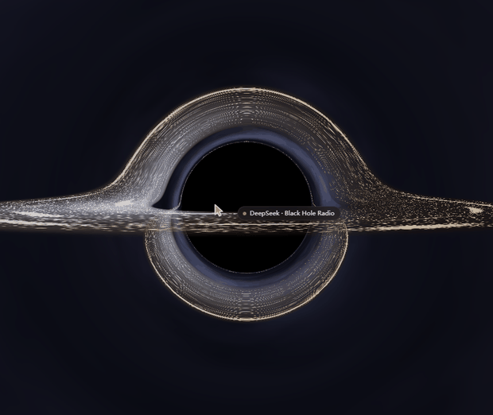

<div align="center">



# Black Hole Radio

A 3-D black-hole stage for internet radio: over twenty thousand real stations orbit a hole you can orbit, zoom into and play.

[中文](README.md) · [MIT license](LICENSE) · [Third-party notices](THIRD-PARTY-NOTICES.md) · v1.0.0

</div>

---

## What it is

A plugin for DSH (DeepSeek Harness). Once installed, a radio card appears at the bottom of the left column; its black-hole logo opens a full-page stage:

- Event horizon, photon ring and accretion disk in the middle, three parallax star shells outside;
- 24k real internet stations embedded in the disk — a bright band from afar, individual stations only up close;
- Hold the button to fall through a wormhole into a cluster, where every station is a star point inside a real 3-D volume;
- Click a star point to play it, hover for a card, and read the current track straight from the stream's ICY metadata.

There is no permanent search bar, category sidebar or readout panel. Search and categories appear only when you ask for them.

## Features

**Stage**

- Hand-written orbit camera: left-drag to orbit, wheel to zoom, damped, focus locked on the hole's core.
- Native Three.js; every station lives in one `Points` object with a custom shader — no per-station meshes.
- Three-level LOD: a continuous band with density ripples from afar, disk knots at mid distance, individual stations and nearby names up close (names are painted on a 2-D canvas, never in the DOM).
- The cluster is a real volume: radial density `u^1.9`, three seeded filaments, vertical squash 0.82, five micro-sprites per station scattered into 2–5 px knots.
- The wormhole between hole and cluster shares one clock: the ring and the shadow expansion start on the first frame of the press, unwind together with a 0.22 s damped recoil on release, and a re-press mid-recoil continues from the current progress instead of jumping.

**Stations**

- Starts from a bundled snapshot of 24k stations, every one probed healthy at build time; falls back to a live fetch when the snapshot is missing.
- Search across name, country/region, language and category; the category panel offers 13 genres.
- Play/pause, previous, random next, volume; dead streams go to a blacklist instead of being retried forever.
- Hover card: click to play, right-click or the star to favourite, with the genre and a `LIVE` badge.
- Now-playing comes from the stream's `icy-metaint` metadata block; clicking the title searches that song on Spotify, NetEase Cloud Music, QQ Music, Apple Music or YouTube (the platform is switchable with a right-click).
- Favourite stations and liked songs persist locally, never synced.
- Chinese / English follow the app language.

## Install

Requirements: Node.js ≥ 20, DSH (verified on 0.2.1-rc.2).

```bash
# from npm (published release)
dsh plugin --profile <profile> add dsh-blackhole-radio-lab

# from source
git clone https://github.com/WhatCannotBeSaid/dsh-blackhole-radio-lab.git
dsh plugin --profile <profile> add "C:/path/to/dsh-blackhole-radio-lab"
```

**Restart DSH after installing.** The desktop process has no profile watcher, and the same holds after rebuilding a chunk — the revision is computed at startup.

Uninstall:

```bash
dsh plugin --profile <profile> remove dsh-blackhole-radio-lab
```

## Controls

| Action | Result |
| --- | --- |
| Left-drag | Orbit the hole |
| Wheel | Zoom towards the hole |
| Click the centre / Enter | Open search |
| Dwell 600 ms on the centre | Open the category panel (560 ms long-press on touch) |
| Hold left on the hole ≈2.3 s | Fall through the wormhole into the cluster; release to recoil in 0.22 s |
| Hold right in the cluster ≈1.2 s | Play the same crossing backwards; a short tap only cancels |
| Press again mid-transition | Continue from the current progress instead of restarting |
| Hover / click / right-click a star | Hover card / play-pause / favourite |
| `Esc` | Close the overlay or step back to the hole |

The footer card owns the station name, the track row, the favourite star, the song like, and play / previous / next / volume.

## Configuration

Mount `config` on the `cordis.patch.yml` entry:

```yaml
- insert:
    - id: blackhole-radio-lab
      name: 'dsh-blackhole-radio-lab'
      config:
        antialias: true
        pixelRatioCap: 2
        reducedMotion: false
        wormhole: true
        showHints: true
        stationCount: 2400
        seed: 20261022
        featuredCount: 18
        catalogAutoRefresh: true
        catalogRefreshDays: 7
        catalogTarget: 30000
        catalogFetch: 50000
        catalogConcurrency: 48
        catalogTimeoutMs: 2800
```

| Key | Default | Range | Meaning |
| --- | --- | --- | --- |
| `antialias` | `true` | boolean | WebGL antialiasing |
| `pixelRatioCap` | `2` | 1–4 | Device-pixel-ratio cap |
| `reducedMotion` | `false` | boolean | Render a single frame instead of animating; transitions also run faster |
| `wormhole` | `true` | boolean | Wormhole transition; `false` restores the instant handover |
| `showHints` | `true` | boolean | Show the on-screen hints |
| `stationCount` | `2400` | 200–20000 | Simulated station count (only with `sourceMode=mock`) |
| `seed` | `20261022` | 0–4294967295 | Seed for data and spatial layout |
| `featuredCount` | `18` | 4–40 | Featured stations on the inner rim |
| `catalogAutoRefresh` | `true` | boolean | Rebuild the catalogue in the background every week |
| `catalogRefreshDays` | `7` | 1–90 | Age at which the cache counts as stale |
| `catalogTarget` | `30000` | 1000–60000 | Stations kept in the user-side snapshot |
| `catalogFetch` | `50000` | 1000–60000 | Candidates fetched before probing; must be ≥ `catalogTarget` |
| `catalogConcurrency` | `48` | 1–64 | Probe concurrency |
| `catalogTimeoutMs` | `2800` | 500–15000 | Per-stream probe timeout |

Anything omitted falls back to `DEFAULTS` in `index.js`. For debugging you can also override the count with `?bhrlStations=5000` on the page URL, and disable the wormhole with `?bhrlWormhole=0` for A/B.

## Data and privacy

- The catalogue comes from the public [Radio Browser](https://www.radio-browser.info) API. The bundled snapshot is fetched, probed and balanced per country and genre by `tools/build-catalog.mjs`; its build time and station count are listed in [THIRD-PARTY-NOTICES.md](THIRD-PARTY-NOTICES.md).
- On the user side the snapshot is rebuilt once a week while DSH is running and written to `$DSH_HOME/cache/blackhole-radio-lab/`. Nothing runs when DSH is closed; a failure is logged and retried six hours later.
- Playback connects the browser straight to the station's stream, and the track title comes from that stream's ICY block (the host reads exactly one block and disconnects). Those connections expose your IP to the station; the author's server is not involved and sees nothing.
- Favourites, liked songs and the dead-stream blacklist are written only to `$DSH_HOME/blackhole-radio-lab/library.json` and never uploaded.
- No remote scripts, no CDN: Three.js is the plugin's own private dependency.

## Architecture

The plugin has two halves: a dependency-free Host half (`index.js` + `src/host/`) that serves config, a static route, the catalogue refresh and track probing, and a browser half shipped as two on-demand chunks.

| Path | Role |
| --- | --- |
| `index.js` | Host entry: config validation (standard schema), routes, teardown |
| `src/host/library.js` | Local record of favourites and blacklist (atomic writes) |
| `src/host/catalog-builder.js` | Catalogue builder: fetch, probe, balance (shared by CLI and host) |
| `src/host/catalog-refresh.js` | Weekly background refresh and fallback rules |
| `src/host/now-playing.js` | ICY metadata probe (a single block, then disconnect) |
| `client.js` | Browser entry: React components, styles, slot registration, lazy loading, teardown |
| `src/stage.js` | Render entry: renderer / scene / camera, rAF, pointer state machine, wormhole |
| `src/scene/` | Horizon, photon ring, disk, starfield, orbit camera, shared GLSL |
| `src/nodes/` | Station micro-structure layer, cluster layer, 2-D canvas labels |
| `src/cluster/` | Cluster layout and offline projection measurements |
| `client.stage.js` / `client.radio.js` | **Build artifacts** — never hand-edited |
| `cordis.patch.yml` | Bundle patch layer, one loader entry |

Both chunks are downloaded only when needed:

```js
window.__ModuleLoader__.load({
  id: 'dsh-blackhole-radio-lab',
  chunk: 'client.stage.js',
  factory(require) { /* three is inlined; no bare module requests */ },
});
```

A chunk's URL derives from the **entry bundle's** revision, so the build bumps `client.js`'s mtime whenever an artifact really changed. Without that bump the browser keeps serving the previous chunk from its immutable cache.

## Development

```bash
npm install      # three + esbuild
npm run build    # rebuild client.stage.js and client.radio.js
npm test         # contract tests for the transition and the artifacts
```

- **Edit `src/` only, then `npm run build`.** The two `client.*.js` files are artifacts.
- Never `import 'three'` in `client.js`: the browser side has no base module for it and resolution fails outright.
- `client.js` is hand-written, not generated — but after editing it you must evaluate the real module-loading path (`npm test` does: it stubs `window.__ModuleLoader__.load` in a vm and asserts `factory` returns `apply` / `inject`).
- Rebuilding the catalogue snapshot: `npm run build:catalog` (`CATALOG_TARGET`, `CATALOG_FETCH`, `CATALOG_CHECK_CONCURRENCY` … override the defaults). Probing twenty thousand third-party streams takes minutes to tens of minutes, which is why it is not part of `npm run build`.

### What the tests do and do not cover

`npm test` is plain Node, no browser: 39 transition cases (immediate motion on press, recoil on release, re-press mid-recoil without a jump, one hold equals one crossing), 89 real source-cell and projection mappings, the real SVG ring's timing, and a loader smoke test for both chunk artifacts.

It does **not** cover the GPU or the browser: shader compilation, real frame rate and the look of the HDR tone mapping still need a human on real hardware.

## Known limitations

- No accounts, no cloud sync, no playlists: favourites and likes stay on the machine.
- Some stations 404, drop the stream, or are region-locked; blacklisted ones are not retried.
- The live-fetch path takes at most 5,000 stations per run (paging plus a time budget); the bundled snapshot is far larger. A snapshot older than 30 days, or one that suddenly shrinks, falls back to live fetching.
- `reducedMotion` shortens transitions rather than removing them entirely.
- At the closest zoom, dense regions still hide some labels behind their neighbours.

## Contributing

Issues and pull requests are welcome. Run `npm run build && npm test` before you open one, and **never hand-edit** `client.*.js` or `data/catalog*.json.gz`.

## License

Code is released under [MIT](LICENSE). Sources, licences and obligations for third-party components and data are in [THIRD-PARTY-NOTICES.md](THIRD-PARTY-NOTICES.md).
