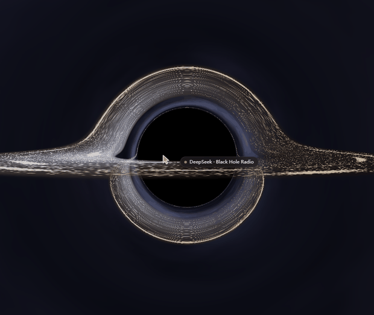

<div align="center">



# 黑洞电台 · Black Hole Radio

一块给网络电台用的 3D 黑洞舞台：两万多台真实电台绕着一颗可以环绕、可以播放的黑洞运行。

[English](README.en.md) · [MIT 许可](LICENSE) · [第三方声明](THIRD-PARTY-NOTICES.md) · [变更日志](CHANGELOG.md) · v1.2.0

</div>

---

## 这是什么

DSH（DeepSeek Harness）的插件。装上之后左栏底部多一张电台卡片，点卡片上的黑洞图标进入全屏舞台：

- 中央是事件视界、光子环与吸积盘，外围是三层视差星场；
- 2.4 万台真实网络电台嵌在吸积盘里，远看是一条亮带，靠近才认得出单个电台；
- 按住不放会穿过一段虫洞落进星团，星团里每台电台是三维体积中的一个星点；
- 点一下星点就播放，悬停出卡片，曲目信息直接来自电台流里的 ICY 元数据。

页面没有常驻搜索栏、分类侧栏或读数面板。搜索和分类只在你主动去点的时候出现。

## 功能

**舞台**

- 手写轨道相机：左键拖动环绕、滚轮缩放、阻尼收敛，镜头焦点锁在黑洞核心。
- 原生 Three.js，单个 `Points` + 自定义着色器承载全部电台，不为每台电台建 Mesh。
- 远中近三级 LOD：远看连续亮带与密度起伏，中距分辨盘面亮结，近距才显示单个电台与附近台名（台名画在 2D canvas 上，不进 DOM）。
- 星团是真实三维体积：径向密度 `u^1.9`、三条种子纤维、垂直压扁 0.82，每台电台 5 个微 sprite 在目标处散成 2–5 px 的星结。
- 黑洞与星团之间是虫洞转场：环形进度与阴影扩张共用同一个时钟，按下第一帧就开始动；松手时画面与环一起阻尼回抽；回弹途中再按一次从当前进度续接，不跳变。

**电台**

- 2.4 万台以内置快照启动（构建时已逐条探活），缺快照时回落实时抓取。
- 搜索覆盖台名、国家地区、语言、分类；分类面板分 13 个流派。
- 播放 / 暂停、上一台 / 随机下一台、音量；启动或卡顿超过 15 秒时，同台最多重连一次，不自动换台。
- 记住音量与最后成功播放站，重开不自动出声；支持系统播放 / 暂停 / 停止控制。后台暂停曲目查询，回到前台立即刷新。
- 悬停卡片：点击播放、右键或星标收藏、显示流派与 `LIVE` 徽标。
- 转场按可用的帧时间让步：转场期间若连续出现慢帧，先按视口面积把渲染像素压到 70 万以内，仍然吃紧再逐次降到 0.8 倍，最低 0.5；空闲后自动爬回原倍率。星点尺寸跟随像素比，降精度不会把星星画大。
- 正在播放的曲目取自流内 `icy-metaint` 元数据块；点歌名可在 Spotify / 网易云音乐 / QQ 音乐 / Apple Music / YouTube 中搜索该曲（平台可右键切换）。
- 收藏的电台与喜欢的歌曲持久保存在本机，不联网同步。
- 中文 / English 跟随应用语言。

## 安装

先决条件：Node.js ≥ 20，DSH（已验证 0.2.1-rc.2）。

```bash
# 从 npm（发布版）
dsh plugin --profile <profile> add dsh-blackhole-radio-lab

# 从本地源码
git clone https://github.com/WhatCannotBeSaid/dsh-blackhole-radio-lab.git
dsh plugin --profile <profile> add "C:/path/to/dsh-blackhole-radio-lab"
```

装完**必须重启 DSH**。桌面端进程不会自己发现新 bundle，重建 chunk 之后同理——revision 是启动时算的。

卸载：

```bash
dsh plugin --profile <profile> remove dsh-blackhole-radio-lab
```

## 上手

| 操作 | 结果 |
| --- | --- |
| 左键拖动 | 绕黑洞旋转 |
| 滚轮 | 以黑洞为中心缩放 |
| 点击黑洞中心 / 回车 | 打开搜索 |
| 指针在中心停留 600 ms | 展开分类面板（触屏长按 560 ms） |
| 黑洞上按住左键 ≈2.3 s | 穿过虫洞进入星团；松手 0.22 s 回抽 |
| 星团中按住右键 ≈3 s | 星点沿同向旋卷内收、收拢成盘，再接回黑洞；短按只撤销不回弹 |
| 转场途中再按同一键 | 从当前进度续接，不重头再来 |
| 星点上悬停 / 点击 / 右键 | 悬停卡片 / 播放暂停 / 收藏 |
| `Esc` | 关闭浮层或退回黑洞 |

底部卡片独占：站名、曲目行、收藏星标、喜欢心标、播放 / 上一 / 下一 / 音量。

## 配置

`cordis.patch.yml` 的条目上可挂 `config`：

```yaml
- insert:
    - id: blackhole-radio-lab
      name: 'dsh-blackhole-radio-lab'
      config:
        antialias: true
        pixelRatioCap: 2
        reducedMotion: false
        wormhole: true
        showHints: true
        stationCount: 2400
        seed: 20261022
        featuredCount: 18
        catalogAutoRefresh: true
        catalogRefreshDays: 7
        catalogTarget: 30000
        catalogFetch: 50000
        catalogConcurrency: 48
        catalogTimeoutMs: 2800
```

| 键 | 默认 | 范围 | 作用 |
| --- | --- | --- | --- |
| `antialias` | `true` | 布尔 | WebGL 抗锯齿 |
| `pixelRatioCap` | `2` | 1–4 | 渲染倍率上限 |
| `reducedMotion` | `false` | 布尔 | 关闭动画，只渲染单帧；转场也更快 |
| `wormhole` | `true` | 布尔 | 虫洞转场；`false` 恢复瞬时切换 |
| `showHints` | `true` | 布尔 | 显示操作提示 |
| `stationCount` | `2400` | 200–20000 | 模拟数据台数（`sourceMode=mock` 时生效） |
| `seed` | `20261022` | 0–4294967295 | 数据与空间分布随机种子 |
| `featuredCount` | `18` | 4–40 | 内环精选台数 |
| `catalogAutoRefresh` | `true` | 布尔 | 是否每周在后台刷新目录快照 |
| `catalogRefreshDays` | `7` | 1–90 | 缓存超过多少天算过期 |
| `catalogTarget` | `30000` | 1000–60000 | 用户侧快照保留台数 |
| `catalogFetch` | `50000` | 1000–60000 | 探测前抓取的候选数，须 ≥ `catalogTarget` |
| `catalogConcurrency` | `48` | 1–64 | 探测并发 |
| `catalogTimeoutMs` | `2800` | 500–15000 | 单条探测超时 |

未给的键回落到 `index.js` 里的 `DEFAULTS`。调试时也可以给页面加 `?bhrlStations=5000` 临时覆盖台数，加 `?bhrlWormhole=0` 关掉虫洞做 A/B。

## 数据来源与隐私

- 电台目录来自 [Radio Browser](https://www.radio-browser.info) 的公开 API。发布包里的快照由 `tools/build-catalog.mjs` 抓取、逐条探活、按国家与流派保底筛洗而成，构建时间与台数写在 [THIRD-PARTY-NOTICES.md](THIRD-PARTY-NOTICES.md)。
- 用户侧每周在 DSH 运行期间后台重建一次快照，写入 `$DSH_HOME/cache/blackhole-radio-lab/`；DSH 没开就不跑，失败只记日志、六小时后再试。
- 播放时浏览器直接连电台的流地址，曲目信息来自该流的 ICY 元数据块（Host 只取一个块即断开）。这些连接会把你的 IP 暴露给对应电台，作者服务器不参与、也看不到。
- 收藏、喜欢的歌曲、音量与最后成功播放站保存在本机 `$DSH_HOME/blackhole-radio-lab/library.json`；失效源记录保存在当前浏览器 IndexedDB，不上传。
- 插件不加载远端脚本，不引 CDN，Three.js 是包内私有依赖。

## 架构

插件分两半：Host 半（`index.js` + `src/host/`）只做配置、静态路由、目录刷新与曲目探测，零运行时依赖；浏览器半被打成两个按需下载的 chunk。

| 路径 | 作用 |
| --- | --- |
| `index.js` | Host 入口：配置校验（标准 schema）、路由、卸载清理 |
| `src/host/library.js` | 收藏、歌曲与播放偏好的本机记录（原子写） |
| `src/host/catalog-builder.js` | 目录构建：抓取、探活、保底筛洗（CLI 与 Host 共用） |
| `src/host/catalog-refresh.js` | 每周后台刷新调度与回落规则 |
| `src/host/now-playing.js` | ICY 元数据探测（只读一个元数据块） |
| `client.js` | 浏览器入口：React 组件、样式、槽位注册、懒加载、卸载清理 |
| `src/stage.js` | 渲染入口：renderer / 场景 / 相机、rAF、指针状态机、虫洞转场 |
| `src/scene/` | 黑体、光子环、吸积盘、星场、轨道相机、共用 GLSL |
| `src/nodes/` | 电台微结构层、星团层、2D canvas 标签层 |
| `src/cluster/` | 星团布局与离线投影测量 |
| `client.stage.js` / `client.radio.js` | **构建产物**，不要手改 |
| `cordis.patch.yml` | bundle 补丁层，一行 loader 条目 |

两个 chunk 只在需要时才下载：

```js
window.__ModuleLoader__.load({
  id: 'dsh-blackhole-radio-lab',
  chunk: 'client.stage.js',
  factory(require) { /* three 已内联，没有裸模块请求 */ },
});
```

chunk 的 URL 取自**入口包**的 revision，所以构建脚本会在产物真的变化时顶一下 `client.js` 的 mtime——不顶这一下，浏览器会拿 immutable 缓存里的旧 chunk。

## 本地开发

```bash
npm install      # three + esbuild
npm run build    # 重建 client.stage.js 与 client.radio.js
npm test         # 转场与产物的契约测试
```

- **只改 `src/`，然后 `npm run build`。** 两个 `client.*.js` 是产物。
- 不要在 `client.js` 里 `import 'three'`：浏览器侧没有 `three` 的基座模块，解析会直接失败。
- `client.js` 本身不是构建产物，直接改；但改完必须求值一次真实的模块加载路径（`npm test` 会做：在 vm 里提供 `window.__ModuleLoader__.load`，断言 `factory` 返回 `apply` / `inject`）。
- 重建目录快照：`npm run build:catalog`（`CATALOG_TARGET`、`CATALOG_FETCH`、`CATALOG_CHECK_CONCURRENCY` 等环境变量控制，探测两万台第三方流要几分钟到几十分钟，所以不放进 `npm run build`）。

### 测试覆盖到哪

`npm test` 是纯 Node 的契约测试，不需要浏览器：40 个转场用例（含按下即动、松手回抽、回弹复按不跳变、一次长按只跨越一次、回程单向旋卷与近零进度取消）、自适应像素比的预算与回落、89 组真实源码取色与投影映射、真实 SVG 环的时序、以及两个产物 chunk 的 loader 注册冒烟。

它**不**覆盖 GPU 与浏览器观感：着色器编译、实际帧率、HDR 色调映射的观感只能靠人眼在真机上看。

## 已知限制

- 无账号、无云同步、无歌单：收藏与喜欢只在本机。
- 部分电台会 404、断流或只在特定地区可用。格式或解码失败的电台隔离 6 小时，下次初始化目录时重新放行；旧的无时间戳黑名单会释放。当前会话不会自动重建目录。
- 关闭窗口时 `pagehide` 立即停止播放；最小化但仍出声时每 3 秒探活本机后端，连续 2 次未应答才停，单次探测 2.5 秒超时也算未应答。
- 系统媒体控制以 metadata 身份避让其他播放器，无法识别只更换 handler 而不更新 metadata 的外部接管。
- 实时抓取路径每次最多取 5,000 台（分页 + 时间预算），内置快照远大于此；快照过期 30 天或台数骤减时会回落实时抓取。
- `reducedMotion` 下转场时间更短，不是完全无动画。
- 缩放到最近处时，密集区域的台名仍会互相让位，极端密度下会有标签不显示。

## 贡献

Issue 与 PR 都欢迎。提交前请跑 `npm run build && npm test`，并且**不要手改** `client.*.js` 或 `data/catalog*.json.gz`。

## 来源与致谢

本站的所有代码与美术资源都是自研，没有从下列项目复制代码、样式或文案。它们在这个领域里先走了一步，本站的设计参考过它们的思路与交互：

| 项目 | 许可 | 本站参考了它的什么能力 | 本站自己的做法 |
| --- | --- | --- | --- |
| [CXZAAA/dsh-radio](https://github.com/CXZAAA/dsh-radio) | MIT | 把电台做成 DSH 的常驻入口、切台不叠音、失败静默降级、曲目信息来自流内元数据、记忆上次收听与音量 | 入口放在左栏底部卡片，台源改用 2.4 万台内置快照；`icy-metaint` 由 Host 只读一个元数据块，失败按同台重连一次，偏好写入 `$DSH_HOME` 原子文件 |
| [joeseesun/qiaomu-radio-dsh](https://github.com/joeseesun/qiaomu-radio-dsh) | GPL-3.0-or-later | 全球电台目录与分类浏览、按场景分组收听、本机口味记忆、系统媒体控制 | 目录改为构建期探活筛选的 Radio Browser 快照，分类收进黑洞舞台的 13 个流派形态；口味记在本机，不含任何 GPL 代码，因此本站仍以 MIT 发布 |
| [ebruneton/black_hole_shader](https://github.com/ebruneton/black_hole_shader) | BSD-3-Clause | 实时黑洞渲染的参考实现 | 直接沿用它预计算的零测地线查找表与 `TraceRay` 结构（唯一真正复制代码的地方），盘面材质、背景与相机自研；细节见 [THIRD-PARTY-NOTICES.md](THIRD-PARTY-NOTICES.md)，BSD 全文随包分发于 [LICENSE-BLACK_HOLE_SHADER](LICENSE-BLACK_HOLE_SHADER) 并内联在 `client.stage.js` 顶部 |
| [three.js](https://github.com/mrdoob/three.js) | MIT | 全部三维渲染的基座 | 构建期内联进 `client.stage.js` |

性能目标与自适应精度策略（降分辨率优先于降帧率）是本站自己的工程约定，没有照搬任何项目；`@deepseek-ai/dsh-client-ui-sidebar` 只是宿主提供的注入点。

## 许可

代码以 [MIT](LICENSE) 发布。第三方组件与数据的来源、许可与义务见 [THIRD-PARTY-NOTICES.md](THIRD-PARTY-NOTICES.md)。
